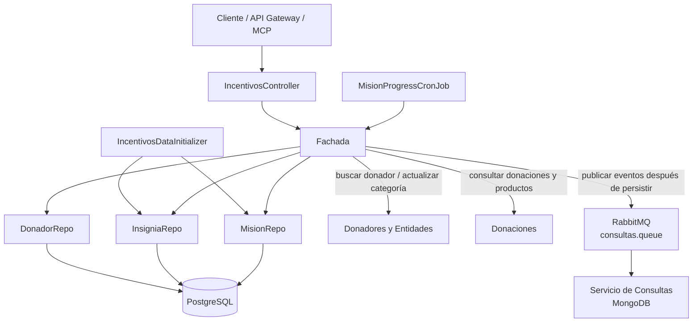
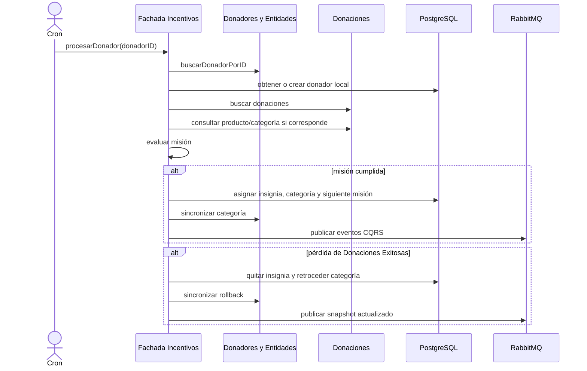

# Arquitectura – Servicio de Incentivos – Entrega 6

## Responsabilidad

Incentivos mantiene las insignias, misiones, categorías e historial de
categorías de cada donador. Consulta donadores y donaciones mediante HTTP,
evalúa misiones y sincroniza los cambios de categoría con Donadores y
Entidades. Las estadísticas generales pertenecen a los módulos
correspondientes, no a Incentivos.

## Componentes



La aplicación se despliega en Render con PostgreSQL. Spring Data JPA utiliza
la base de escritura del componente. El modelo de lectura CQRS no es fuente de
verdad de Incentivos: recibe eventos asincrónicos y mantiene sus propios
documentos en MongoDB.

## Inicialización de datos base

`IncentivosDataInitializer` implementa `CommandLineRunner` y carga de forma
idempotente, al iniciar la aplicación:

- Insignias de Completitud, Donaciones Exitosas, Donaciones Ascendentes y
  Revolución Donadora.
- Las cuatro misiones base asociadas a esas insignias.

Si la base se elimina, el siguiente arranque las vuelve a crear. `DELETE
/reset` también limpia la base y recarga esos datos inmediatamente.

Cuando Incentivos detecta por primera vez a un donador, crea su entidad local y
le asigna `Completitud`. Al completarla, asigna automáticamente
`Donaciones Exitosas`. Las dos misiones finales quedan para una elección
posterior del donador.

## Integraciones HTTP

| Origen | Destino | Operación |
|---|---|---|
| Incentivos | Donadores y Entidades | Buscar donador |
| Incentivos | Donadores y Entidades | Modificar categoría |
| Incentivos | Donadores y Entidades | Listar donadores para el cron |
| Incentivos | Donaciones | Buscar donaciones por donador y fecha |
| Incentivos | Donaciones | Buscar producto |
| Incentivos | Donaciones | Buscar subcategoría |

Las URLs se configuran mediante `URL_DONADORES_ENTIDADES` y `URL_DONACIONES`.
En el despliegue integrado, estas URLs pueden apuntar al API Gateway según la
configuración del grupo.

## Flujo de procesamiento



## Cron y observabilidad

`MisionProgressCronJob` procesa periódicamente donadores externos y donadores
locales con misión asignada. El intervalo se configura con
`INCENTIVOS_PROCESAMIENTO_INTERVALO_MS`.

Se exponen métricas Micrometer para procesamientos, errores, duración,
misiones completadas, avances, rollbacks, integraciones y publicación de
eventos. Los logs incluyen el componente, operación, donador y errores de
integración. La exportación a Datadog y el logging centralizado se configuran
por variables de entorno.

## Eventos CQRS

Cuando `INCENTIVOS_EVENTOS_ENABLED=true`, se publican en la cola durable
`consultas.queue` eventos con:

```json
{
  "id": "uuid",
  "tipo": "DONADOR_ACTUALIZADO",
  "version": 0,
  "ocurridoEn": "2026-10-20T14:32:10Z",
  "payload": {}
}
```

Los tipos publicados por Incentivos son `DONADOR_ACTUALIZADO`,
`INSIGNIA_ASIGNADA` y `MISION_ASIGNADA`. El Servicio de Consultas consume estos
eventos y actualiza MongoDB sin consultar módulos en tiempo de lectura.
